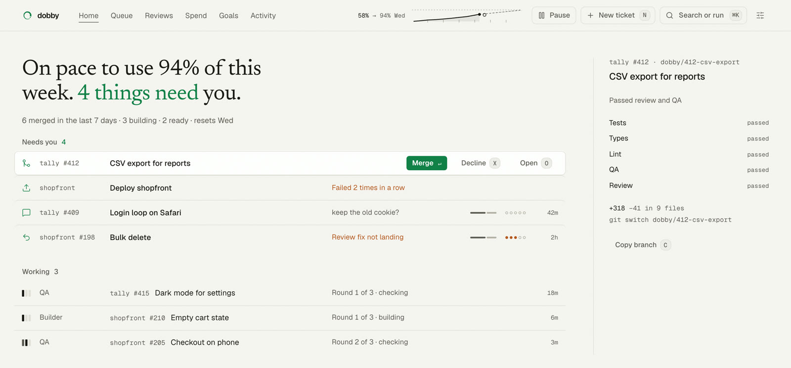
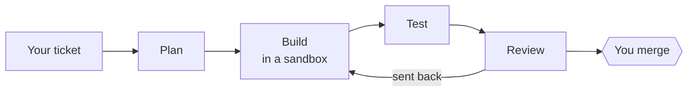

<div align="center">

<picture>
  <source media="(prefers-color-scheme: dark)" srcset="docs/readme/mark-dark.svg">
  
</picture>

# Dobby

**An AI team on your own computer.**<br>
Give it a ticket. It plans, builds, tests and reviews the change, then opens a pull request.

[](https://www.npmjs.com/package/dobby-ai) [](LICENSE) [](docs/manual/install.md)

[Website](https://dobby.dapplelight.in) · [Docs](https://dobby.dapplelight.in/docs) · [Your first hour](docs/manual/first-hour.md) · [Security](docs/manual/security.md)

</div>

<picture>
  <source media="(prefers-color-scheme: dark)" srcset="docs/readme/dashboard-dark.jpg">
  
</picture>

<p align="center"><sub>The dashboard, on made-up projects.</sub></p>

## How it works



- **Runs on your machine.** Builders work in an OS sandbox. Their commands get no network and no credentials. Only Dobby pushes, after the checks pass.
- **Runs on your own plan.** It uses the AI plan you already pay for, or an API key, and paces itself so part of your weekly limit is left for you.
- **Your code stays with you.** It goes only to your model provider. Usage stats are off unless you turn them on.

## Quick start

You need macOS or Linux (WSL2 on Windows), Node 24, git with `user.email` set, and 15 GB of free disk. Dobby runs on Claude Code only today. Support for other agent harnesses is coming.

Sign in to the GitHub CLI, let git push with that sign-in, then sign in to Claude Code (a Pro or Max plan, or an Anthropic API key):

```sh
gh auth login
gh auth setup-git
claude
```

Install Dobby. This puts the `dobby` command on your PATH. `npx dobby-ai init` also runs setup, but it does not keep the `dobby` command.

```sh
npm i -g dobby-ai
dobby init
```

If npm warns that better-sqlite3 has install scripts that are not allowed, Dobby still works. See [Install](docs/manual/install.md).

`dobby init` looks for repos with a GitHub remote in ~/projects, ~/code, ~/dev, ~/src, ~/work, ~/Developer, ~/repos and ~/GitHub. For another folder, run `dobby init --projects <folder>`.

Setup asks before it installs the background jobs that build while you are away. To try Dobby without them, skip the jobs and keep `dobby start` open in a terminal:

```sh
dobby init --no-jobs
dobby start
```

Then write a ticket: a project, a title and a done-when line.

```sh
dobby add shopfront "Fix the footer spacing" "the footer has 16px padding on phones"
dobby status
```

[Your first hour](docs/manual/first-hour.md) follows that ticket to a merged pull request.

## The team

Each role is a separate agent run with its own instructions.

| Role | Its job |
| --- | --- |
| Product Manager | Ranks problems and writes specs. |
| Engineering Manager | Plans the work and queues tickets. |
| Designer | Specs screens before a UI build. |
| Builder | Writes the change, in the sandbox. |
| Tester | Tries to break it before review. |
| Code Reviewer | Reviews every pull request. |
| Chief of Staff | Sends a morning and evening brief. |
| Talent Scout | Improves one role a day. |

## What waits for you

- A fresh install opens pull requests but does not merge them until you run `dobby resume merges`.
- Deploys wait for your tap by default, and a migration that changes existing data always waits.
- The safety preset (Balanced, Strict or Autonomous) decides which other changes wait for you.
- You can approve from the terminal, the dashboard, Discord, or any MCP client.

## Docs

The docs are at [dobby.dapplelight.in/docs](https://dobby.dapplelight.in/docs). The same pages are in [docs/manual](docs/manual/), and `dobby docs` prints them in your terminal.

- [Your first hour](docs/manual/first-hour.md)
- [What waits for you](docs/manual/what-waits.md)
- [Security and the sandbox](docs/manual/security.md)
- [CLI reference](docs/manual/cli.md)

## Development

```sh
npm install
npm test              # unit tests, fast
npm run e2e           # tickets from start to merge, with a fake Claude and a fake GitHub (tests/e2e); offline
npm run coverage      # everything above, with a line-coverage gate on src/
npm run typecheck
npm run docs          # regenerate the generated manual pages and llms.txt
```

The dashboard and these docs are built on [Signet](https://github.com/dapplelight/signet), our open-source design system and backend kit.

## Contributing

Dobby is not taking pull requests yet. Bug reports and ideas are welcome as [issues](https://github.com/dapplelight/dobby/issues).

## License

MIT. Some skills are copied from other projects and keep their own licenses: see [THIRD_PARTY.md](THIRD_PARTY.md).
